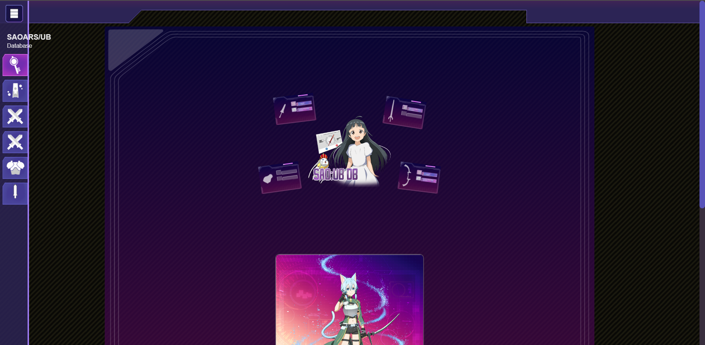

# Front SAOARS/UB

Base de données non officielle de Sword Art Online Unleash Blading. L'interface reprend celle de
[saoub.fanadata.com](https://saoub.fanadata.com/) (relevé dans [docs/fanadata](docs/fanadata/README.md)),
et les données viennent de l'[API SAOARS](https://github.com/Renaudfradin/API-SAOARS).

## Project Setup

```sh
npm install
cp .env.example .env
```

### Compile for Development

```sh
npm run dev
```

L'API doit tourner en parallèle (dans `API-SAOARS` : `./vendor/bin/sail up`, port 8001).

### Environnement Variable

| Nom de variable    | Valeur                        | Explication                       |
| ------------------ | ----------------------------- | --------------------------------- |
| VITE_BACKEND_URL   | http://localhost:8001/api     | URL de l'API SAOARS (préfixe `/api` inclus) |

### Routes de l'API utilisées

| Route | Usage |
| --- | --- |
| `GET /characters`, `/weapons`, `/equipments`, `/banners`, `/abilities`, `/attacks`, `/imaginations` | Listes paginées (21 par page, `?page=`) |
| `GET /character/{slug}`, `/weapon/{slug}`, `/equipment/{slug}`, `/banner/{slug}`, `/ability/{slug}`, `/attack/{slug}`, `/imagination/{slug}` | Fiches détail |
| `GET /character/random` | Personnage aléatoire de l'accueil |
| `GET /stats` | Compteurs de l'accueil |

Toutes les requêtes ajoutent `?lang=` (fr, en, zh, ko, ja, de, es), choisi avec le sélecteur de langue.
L'API limite à 60 requêtes par minute : les listes sont paginées côté serveur, et toutes les pages
ne sont chargées que lorsqu'un filtre ou une recherche est actif.


